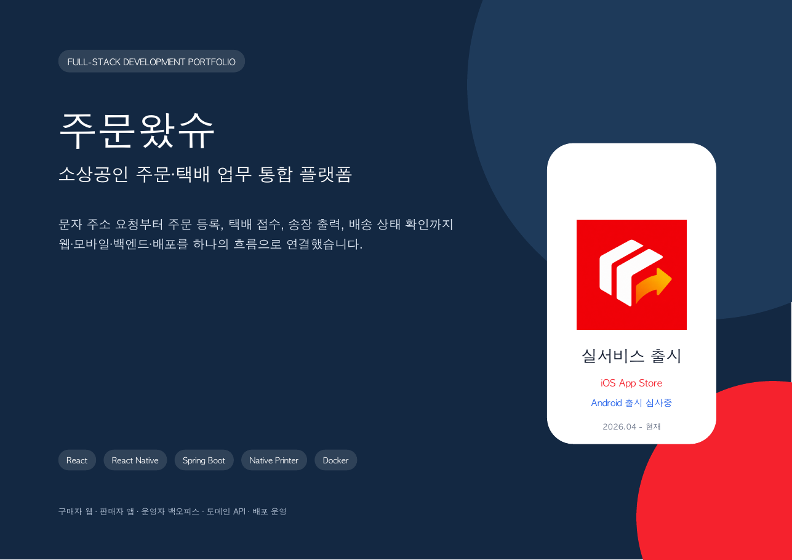
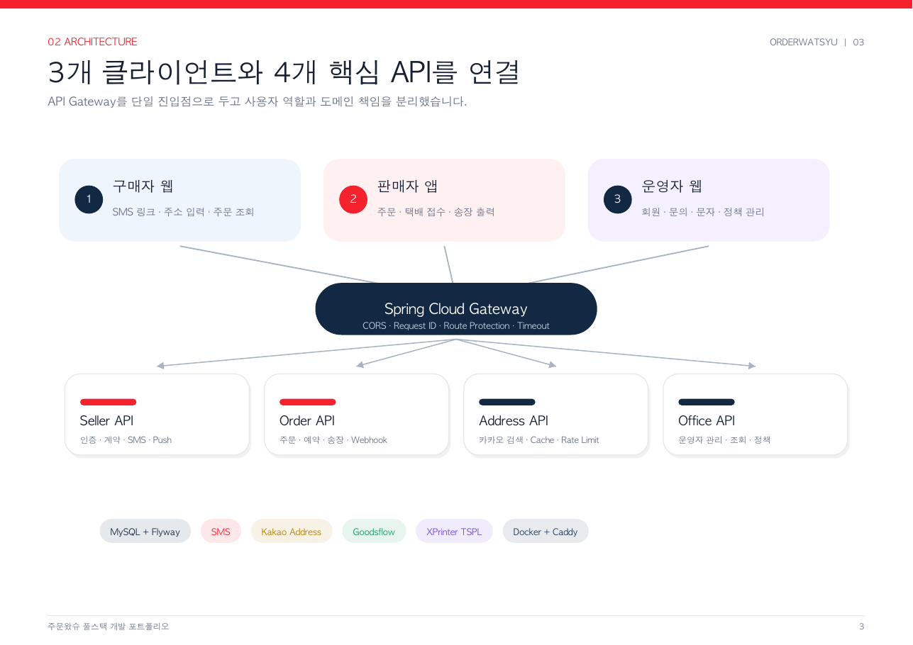

# 주문왔슈 (OrderWatsyu)

> 전화 주문부터 고객 주소 요청, 택배 접수, 송장 출력, 배송 상태 확인까지 연결한 소상공인용 주문·택배 업무 통합 플랫폼입니다.

[](https://apps.apple.com/kr/app/id6827154136)

[](https://customer-web.orderwatsyu.com)

> 이 저장소는 채용 검토를 위한 공개 포트폴리오입니다. 운영 소스 코드, 고객 데이터, API 키, 인증서 및 내부 인프라 정보는 포함하지 않습니다.

## 포트폴리오

- [포트폴리오 PDF 보기](orderwatsyu_fullstack_portfolio.pdf)
- [실서비스 웹](https://customer-web.orderwatsyu.com)
- [iOS App Store](https://apps.apple.com/kr/app/id6827154136)



## 해결한 문제

전화 주문이 많은 소상공인은 고객 주소를 통화나 문자로 다시 확인하고, 판매자와 택배기사가 같은 정보를 여러 번 입력해야 합니다. 주문, 택배 접수, 송장 출력, 배송 상태가 서로 다른 업무로 분리되면서 누락과 재입력이 발생할 수 있습니다.

주문왔슈는 이 과정을 다음과 같이 하나의 사용자 여정으로 연결합니다.

```text
판매자 주문 링크 발송
        ↓
구매자 본인 확인 및 주소 입력
        ↓
주문 등록 / 기존 배송지 재사용
        ↓
택배 접수 / 취소 / 송장 출력
        ↓
배송 상태 확인
```

## 시스템 구성

세 개의 클라이언트와 도메인별 API를 API Gateway를 통해 연결했습니다.



| 영역 | 주요 기능 | 기술 |
|---|---|---|
| 구매자 웹 | 주문 링크, 본인 확인, 주소 등록·수정, 기존 배송지 재사용, 주문 조회 | React, TypeScript, Vite |
| 판매자 앱 | 온보딩, 주소록, 주문, 택배 접수·취소, 알림, 송장 출력 | React Native, Expo |
| 운영자 웹 | 판매자·구매자·문의·문자·운송장·앱 버전 정책 관리 | React, TypeScript |
| Seller API | 인증, 판매자·기사, 택배 계약, SMS, Push, 앱 버전 정책 | Java 17, Spring Boot, JPA |
| Order API | 주문 생명주기, 택배 예약·취소, 송장 PDF, 배송 Webhook | Spring Boot, JPA, PDFBox |
| Address API | 카카오 주소 검색, 요청 검증, 캐시, 호출 제한 | Spring Boot, Caffeine |
| Office API | 운영자 인증 및 운영 데이터 조회·관리 | Spring Boot, MyBatis |
| 운영 환경 | Gateway, HTTPS, 마이그레이션, 배포, 로그 추적, 장애 복구 | Docker, Caddy, Flyway |

## 담당 범위

- 서비스 구조와 사용자 흐름 설계
- 구매자용 React 웹 개발
- React Native/Expo 판매자 앱 개발 및 출시
- Seller·Order·Address·Office API와 Gateway 연동
- Android·iOS XPrinter 네이티브 모듈 구현
- Docker Compose·Caddy·Flyway 기반 배포 및 운영 체계 구성
- 운영자 웹 일부 협업

## 핵심 기술 사례

### 1. 주문 전 과정을 하나의 상태 흐름으로 연결

고객에게 전달되는 일회성 주문 링크부터 주소 입력, 기존 배송지 재사용, 택배 접수와 배송 상태 변경까지 동일한 주문 생명주기에서 관리했습니다.

[자세히 보기](case-studies/order-flow.md)

### 2. Android·iOS 블루투스 송장 출력

React Native 화면 연결에 머무르지 않고 Kotlin, Swift, Objective-C 브리지를 구현했습니다. TSPL 명령 전송, 다중 송장 순차 출력, 상태 조회, 타임아웃, 재연결과 오래된 콜백 무시 로직을 적용했습니다.

[자세히 보기](case-studies/xprinter-integration.md)

### 3. 운영 가능한 배포와 장애 추적

서비스 교체 전 이미지 선빌드, Flyway 마이그레이션, 순차 배포, Health Check와 실패 롤백을 구성했습니다. Gateway에서 생성한 Request ID를 각 서비스에 전달해 하나의 요청을 로그에서 추적할 수 있게 했습니다.

[자세히 보기](case-studies/deployment-and-operations.md)

## 기술적으로 중요하게 본 기준

- **서비스 경계:** 사용자 역할과 데이터 책임을 기준으로 API를 분리
- **상태 일관성:** 주문·접수·취소·배송 완료 상태 전이를 정책과 테스트로 관리
- **실물 기기 대응:** 모바일 OS와 프린터 모델 차이를 네이티브 브리지에서 흡수
- **실패 복구:** 외부 연동 실패에 Outbox·재시도·복구 스케줄러 적용
- **배포 안전성:** DB 마이그레이션과 애플리케이션 교체 순서를 명시적으로 제어
- **관측 가능성:** Request ID 기반으로 Gateway부터 백엔드 로그까지 추적
- **개인정보 보호:** 개인정보 암호화 검증, 호출 제한, 보관 기한과 삭제 흐름 반영

## 주요 기술 스택

```text
Frontend     React 19 · TypeScript · Vite · React Router · Axios
Mobile       React Native 0.86 · Expo 57 · Expo Router · EAS
Native       Kotlin · Swift · Objective-C · Bluetooth · TSPL
Backend      Java 17 · Spring Boot 3.3 · Spring Cloud Gateway
Data         MySQL · Spring Data JPA · MyBatis · Flyway · Caffeine
Infra        Docker · Docker Compose · Caddy · Request ID Logging
Integration  SMS · Kakao Address · Goodsflow · XPrinter
```

## 공개 범위

실서비스의 안전과 계약상 의무를 위해 다음 정보는 공개하지 않습니다.

- 운영 소스 코드와 내부 저장소
- 고객 개인정보와 운영 데이터
- 데이터베이스·서버 주소
- API 키, 인증서, 암호화 키 및 환경 변수
- 외부 택배사 SDK와 계약 정보

대신 시스템 구조, 기술적 판단, 문제 해결 과정과 검증 방법을 중심으로 정리했습니다.

